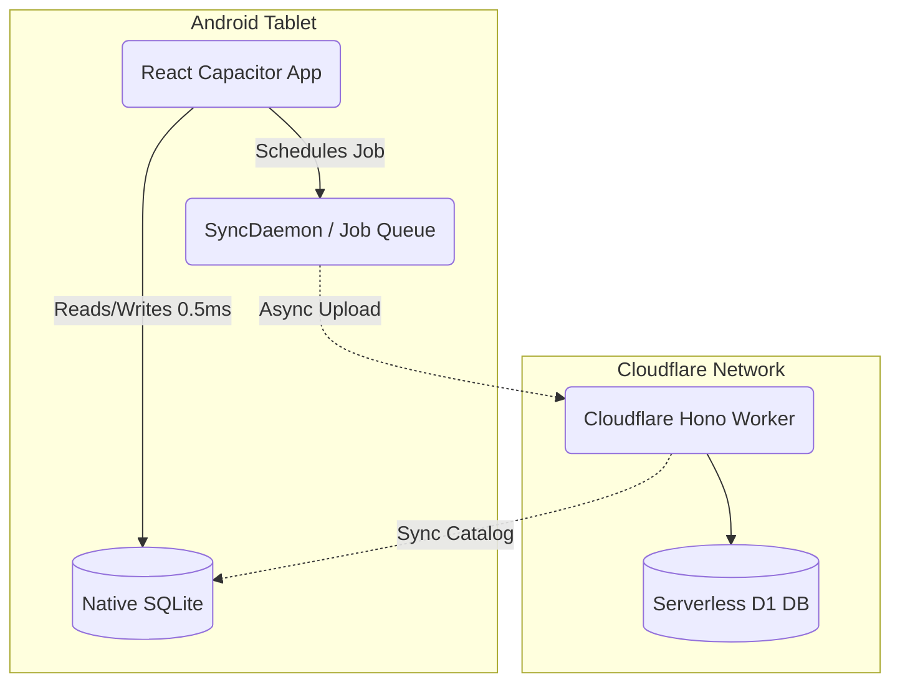

# Architecture

The TBT Cafe POS breaks away from traditional client-server REST paradigms by prioritizing **Local-First Native Transaction Engines**. 

By physically pushing the Source-of-Truth directly inside the tablet's local storage subsystem, the application fundamentally eliminates network latencies and entirely avoids Service Outages from cell carrier drops.

## Systems Flow

## The "Two-Source" Synchronization Layer
Because the app relies completely on `Local SQLite` during normal operations, there are strict roles defining Data Flow bounds:

### Downward Data (Cloud → Android)
Changes originating from the Cafe Owner's master inventory (adding new menu items, updating pricing) are hosted in **Cloudflare D1**.
When the POS opens, the `App.tsx` triggers `syncService.pullCatalog()`. This intercepts the D1 Products JSON payload and natively updates the SQLite `products` table. 

### Upward Data (Android → Cloud)
Changes originating natively (ringing up a customer Order) **immediately** write to local `orders` and `order_items` tables within SQLite. The customer experiences zero delay.
Simultaneously, the API commits a JSON copy to the `sync_queue` table.
The background daemon asynchronously pops items out of the `sync_queue`, streams them to the Cloudflare Worker via `fetch()`, and upon receiving HTTP `200`, natively removes the queue flag.

## Architectural Migrations & Obsolete Technology
- **MongoDB was fully eliminated**. Prior iterations relied on MongoDB serverless connectivity. High geographic round-trip times and unpredictable network offline states proved MongoDB unviable for hardware POS applications. Cloudflare D1 provides equivalent remote syncing utilizing strict relational SQL to match the local tables flawlessly.
- **jeep-sqlite & IndexedDB were rejected**. Standard web database mechanisms (IndexedDB) and web-emulation drivers (jeep-sqlite) are highly susceptible to browser `QuotaExceeded` arbitrary purges. We heavily enforce `@capacitor-community/sqlite`, mapping JavaScript instructions directly to Android C-level SQLite databases which practically bypass OS purging routines indefinitely.

## Void Flow Architecture
Orders are immutable once sent to the Sync Queue. To accommodate Cashier mistakes, Orders are **Voided**.
- If a cashier voids `#104`, the SQLite `orders` table updates that literal order's status to `VOIDED`.
- Cash dashboards correctly exclude `VOIDED` line items from all gross summation revenue.
- The Sync daemon fires a `VOID` patch payload to the Cloud API to enforce the remote D1 void state synchronization idempotently.
