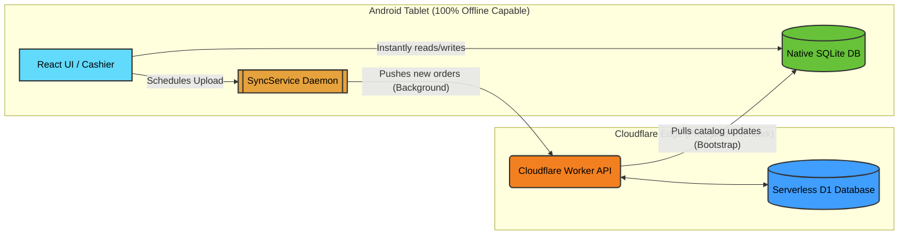

# System Architecture Diagram Guide (For Hand-Drawing)

This guide is designed to help you neatly draw the TBT Cafe POS architecture on a whiteboard or piece of paper for your team. The system is split perfectly into **two halves**: The Android Device (Local Hub) and the Cloud (Master Database).

## How to Draw the Diagram

**Step 1: Draw two large boxes side-by-side.**
- Left Box (Title: **Android Tablet**)
- Right Box (Title: **Cloudflare Edge**)

---

### Step 2: Fill in the "Android Tablet" Box (Left Side)
Draw three internal boxes inside the Tablet box:

1. **React UI (Top)**
   - *Label*: "React / Vite UI"
   - *Purpose*: What the cashier sees and uses.
2. **Native SQLite (Middle)**
   - *Label*: "Native SQLiteDB"
   - *Purpose*: The super-fast, offline primary database handling the orders.
3. **Sync Queue (Bottom)**
   - *Label*: "SyncService Daemon"
   - *Purpose*: The background worker that talks to the internet.

**Draw arrows inside the Tablet:**
- Arrow from **React UI** → **Native SQLite** (Label it: *"Instant 1ms Reads/Writes"*)
- Arrow from **React UI** → **Sync Queue** (Label it: *"Schedules Sync Jobs"*)

---

### Step 3: Fill in the "Cloudflare Edge" Box (Right Side)
Draw two internal boxes inside the Cloud box:

1. **Worker API (Top)**
   - *Label*: "Cloudflare Worker (Hono)"
   - *Purpose*: The smart API gateway connecting the tablets to the remote database.
2. **D1 Database (Bottom)**
   - *Label*: "D1 Serverless Database"
   - *Purpose*: The master remote database holding the master menu and historical analytics.

**Draw arrows inside the Cloud:**
- Arrow from **Worker API** ↔ **D1 Database** (Label it: *"Master Cloud Read/Write"*)

---

### Step 4: Connect the Tablet to the Cloud (The "Bridge")
Draw the network arrows acting as the internet bridge between the two halves:

1. **Orders Going UP:**
   - Draw an arrow from the Tablet's **Sync Queue** → to the Cloud's **Worker API**.
   - *Label it*: *"Asynchronous Background Push (Orders/Voids)"*
2. **Products Coming DOWN:**
   - Draw an arrow from the Cloud's **Worker API** → to the Tablet's **Native SQLite**.
   - *Label it*: *"Instant Bootstrap Sync (Catalog & Prices)"*

---

## Text-Based ASCII Diagram

If you need a quick visual without a renderer, here is the exact mental model physically drawn using standard text (Top-to-Bottom Flow):

```text
                  +-----------------------------------+
                  |      ANDROID TABLET (OFFLINE)     |
                  |                                   |
                  |      +---------------------+      |
                  |      |      REACT UI       |      |
                  |      |   (Cashier View)    |      |
                  |      +---------+-----------+      |
                  |                |                  |
                  |                | Instant 1ms R/W  |
                  |                v                  |
                  |      +---------------------+      |
                  |      |    NATIVE SQLITE    |      |
                  |      | (Primary Local DB)  |      |
                  |      +---------+-----------+      |
                  |                |                  |
                  |                | Schedules Upload |
                  |                v                  |
                  |      +---------------------+      |
                  |      |     SYNC QUEUE      |      |
                  |      |   (Daemon Worker)   |      |
                  |      +---------+-----------+      |
                  |                |                  |
                  +----------------|------------------+
                                   |         ^
    ============================== | ======= | ==============================
           (Local Operations)      |         |     (Network Boundary)
                                   |         |
                      [ORDERS UP]  |         |  [PRODUCTS DOWN]
                                   v         |
                  +-----------------------------------+
                  |      CLOUDFLARE EDGE (ONLINE)     |
                  |                                   |
                  |      +---------------------+      |
                  |      |     WORKER API      |      |
                  |      |    (Hono / API)     |      |
                  |      +---------+-----------+      |
                  |                |                  |
                  |                | HTTPS R/W        |
                  |                v                  |
                  |      +---------------------+      |
                  |      | D1 SECURE DATABASE  |      |
                  |      |  (Source of Truth)  |      |
                  |      +---------------------+      |
                  +-----------------------------------+
```

## Mermaid Diagram Reference (What it should visually look like)

If a team member wants a digital version of this whiteboard drawing, they can reference this Mermaid graph:



## Key Talking Points for the Team Presentation:
When you draw this, explain these 3 things to your team:
1. **"The App NEVER waits for the cloud."** Notice how the React UI only talks to the green SQLite box directly. The cashier never feels network latency.
2. **"Orders flow UP, Products flow DOWN."** The Cloud owns the Products; the Android Tablet owns the Cashier Orders.
3. **"No MongoDB."** Remind the team that MongoDB has been completely removed to embrace native device SQL for faster performance.
