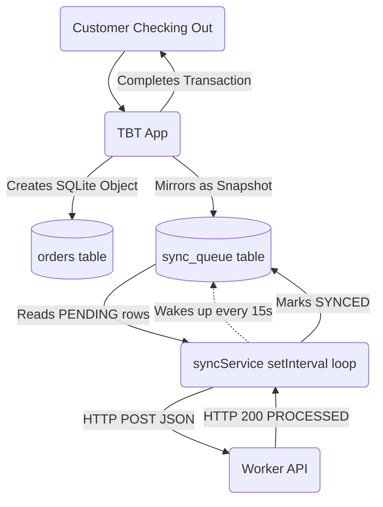

# SyncService & The Sync Queue

The TBT Application hinges deeply across the `SyncService` background daemon loop mapped across `frontend/src/services/syncService.ts`.

## Core Logic Flow
The ultimate goal of the `SyncService` is tracking immutable Native modifications reliably executing background asynchronous payloads regardless of explicit networking states silently eliminating end-user interface blocking.

## Push Iterations (Orders & Voids)
- Upon boot (and subsequently every 15000ms natively loop intervals), the `pushPending` method scrapes ALL database records explicitly defined under `'PENDING'` queue states.
- Triggers loop mapping arrays isolating `'CREATE'` records vs explicit `'VOID'` patches dynamically.
- Compiles payloads via explicit chunked grouping loops spanning EXACTLY 50 maximum limit payloads limiting API byte payloads scaling seamlessly alongside huge offline durations logically.
- `MARK SYNCED`: Upon 200 HTTP code verifications natively catching targeted `id` matches within the Cloudflare response string natively, marks items definitively across the local tables directly as `'SYNCED'`.

## Pull Iterations (Products, Settings & Web Orders)
- Runs identically inside the App boot lifecycle **and subsequently every 15000ms inside the background daemon loop natively**.
- **Bidirectional Ledger Syncing**: D1 natively issues new Web dashboard commands via cursor pagination. SQLite `insertCloudOrderBase` ingests these commands incrementally natively.
- **Immediate Loading Hydration Check (Idempotency):** During the absolute moment `App.tsx` calls `initDB()`, a microsecond evaluation reads if `products` lists 0 native objects natively. If 0 items explicitly evaluate out, an emergency `defaultCatalog` hydration triggers statically pulling exactly 51 baseline JSON payloads guaranteeing Billing views never delay displaying visually due to network buffering dynamically.

## Failsafes and Backoff Restarts
If error objects hit API latency bounds across arbitrary code 400 instances globally:
`sync_queue` records naturally escalate their independent `attempt_count` natively restricting iteration polling dynamically if explicit numbers breach specific numerical caps preventing battery drainage.
